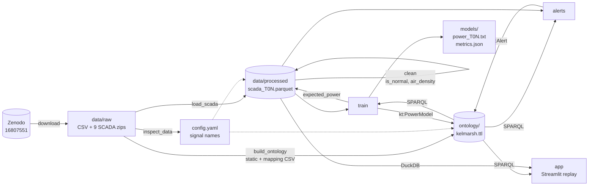

# Kelmarsh Wind Farm Digital Twin (PoC)

A proof of concept of a data-driven digital twin for the Kelmarsh wind
farm (UK, 6 x Senvion MM92, 12.3 MW). It loads and cleans 2016–2024 SCADA data,
describes the farm in an RDF ontology, trains one LightGBM power model per
turbine, raises underperformance alerts, and replays everything in a Streamlit
dashboard. See [docs/spec.md](docs/spec.md) for the full specification.

## Pipeline

The RDF graph (`ontology/kelmarsh.ttl`) is the source of structural truth:
after `build_ontology`, every step discovers turbines, sensors, Parquet paths
and model inputs through SPARQL (`src/graph_utils.py`) and writes its results
(models, alerts) back into the graph. Time series stay in Parquet.



## Setup

Install [uv](https://docs.astral.sh/uv/), then:

```bash
make setup        # uv sync
```

## Run

The download is about 3.7 GB (9 yearly SCADA zips) and unzips to about
43 GB in `data/raw/scada_<year>/`; the 2023 and 2024 exports alone are 17 GB
each (see deviations). The processed Parquet files are much smaller.

```bash
make download     # fetch raw data into data/raw/ (MD5-verified, skips existing)
make inspect      # print raw file structure and column names
make data         # load_scada + clean
make ontology     # build ontology/kelmarsh.ttl
make train        # one power model per turbine
make alerts       # underperformance alerts
make app          # Streamlit dashboard
make all          # download through alerts
```

Every script also runs standalone: `uv run python -m src.<name>`.

## Testing and linting

```bash
make test         # uv run pytest
make lint         # uv run ruff check .
```

## Results

From a clean clone, `uv sync` then `make all` runs in about 160 seconds once
the data is downloaded; about 140 s of that is `load_scada` parsing the raw
CSVs (mostly the 2023 and 2024 files), every later step takes under 10 s.

**Data and cleaning:** each turbine has 473,184 ten-minute rows over
2016–2024 (2.84 million in total): 52,560 per year, 52,704 in the leap years
2020 and 2024, and 52,416 in 2016, whose files start on 3 January. Missing
values are 1.6–2.5 % for wind speed and power and 4.6–5.9 % for the other
signals; 75–80 % of rows are normal. No row before the commercial operations
date (15 April 2016) is normal, so the commissioning period is excluded
from training by the cleaning rules.

**Power models** (`models/metrics.json`, trained on normal rows of
2016–2021, tested on normal rows of 2022–2024, rated power 2,050 kW):

| Turbine | MAE (kW) | nMAE | Train rows | Test rows |
|---|---|---|---|---|
| T01 | 50.7 | 0.025 | 241,807 | 129,779 |
| T02 | 52.9 | 0.026 | 247,003 | 131,722 |
| T03 | 48.7 | 0.024 | 241,497 | 128,971 |
| T04 | 56.7 | 0.028 | 247,502 | 120,537 |
| T05 | 51.6 | 0.025 | 239,946 | 126,404 |
| T06 | 47.3 | 0.023 | 233,463 | 121,920 |

All turbines meet the nMAE < 0.05 target, and every turbine improves on the
2022-only models (nMAE 0.026–0.039 on Q4 2022) despite a three-year test
period.

**Alerts** (24 h rolling residual below −5 % of rated power for at least 6 h):

| Turbine | Alerts | Lost energy (MWh) |
|---|---|---|
| T01 | 2 | 2.5 |
| T02 | 8 | 26.1 |
| T03 | 0 | 0.0 |
| T04 | 11 | 78.8 |
| T05 | 4 | 3.0 |
| T06 | 2 | 0.9 |
| **Total** | **27** | **111.3** |

By year: 1 alert in 2016, 12 in 2022, 12 in 2023 and 2 in 2024. The
clearest finding is T04 from February to April 2023: seven alerts totalling
59.1 MWh, including the largest one, from 2023-03-21 12:20 to 2023-03-26 19:50
(mean residual −16.7 % of rated power, 20.9 MWh). The October 2022 cluster
seen with the 2022-only models is still there (T02 from 2022-10-04 19:20 to
2022-10-08 14:20, 13.3 MWh), so it is not just seasonal drift of a model
trained on January–September.

**Graph:** `ontology/kelmarsh.ttl` holds the schema (11 classes,
40 properties), 6 turbines, 42 sensors, 6 trained power models, 27 alerts,
and the provenance of the data: the dataset and its 65 source files (2 CSVs,
9 SCADA zips and 54 yearly turbine data files). Each sensor is derived from
its turbine's 9 yearly raw files.

## Dashboard

- **Replay** tab: status map, KPI cards, 7-day power chart with alerts,
  power curve (a random sample of at most 50,000 normal rows,
  `dashboard.power_curve_max_points`), alerts table and the sensors SPARQL
  query.
- **Ontology & lineage** tab: a Graphviz diagram of the selected turbine
  traced back to its sources (specs → `Kelmarsh_WT_static.csv`; each sensor's
  readings → its 9 yearly raw `Turbine_Data_…csv` files → each year's SCADA
  zip → the Zenodo
  dataset, and the signal mapping CSV), with a sensor filter and active
  alerts in red, plus a class diagram of the schema. Both are built from
  SPARQL queries shown in the tab.

## Known limitations

- Simple cleaning rules (spec §7.4): a derating plateau at about 1,650 kW above
  rated wind speed is not removed, because the pitch rule only applies below
  rated wind speed.
- No validation of alerts against the status/event logs.
- Alerts are computed on all years, including the training years
  2016–2021, where the residuals are in-sample and therefore small; only
  one alert falls there (T01, August 2016). Alerts in 2022–2024 are
  out-of-sample.
- One model per turbine is trained once on 2016–2021; slow changes after
  2021 (e.g. ageing, control updates) show up as residuals rather than being
  learned.
- Replay is a historical simulation (no streaming), and the dashboard loads
  all 9 years of the 6 turbines into memory (about 2.84 million rows).

## Attribution

Kelmarsh wind farm data by Cubico Sustainable Investments Ltd, licensed under
CC-BY-4.0. DOI: [10.5281/zenodo.16807551](https://doi.org/10.5281/zenodo.16807551).

## Deviations from spec

- `config.yaml` additionally holds the download URLs/MD5s, the sample interval,
  the rated wind speed (12 m/s) and the standard pressure, so no values are
  hard-coded in scripts.
- `matplotlib` is added (not in spec §4) to save the power curve PNGs.
- `pytest`, `ruff` and `watchdog` (faster Streamlit reloads) are added as dev
  dependencies.
- The SCADA archive holds 6 `Turbine_Data_Kelmarsh_<N>_…csv` files and
  6 `Status_Kelmarsh_<N>_…csv` files (status/event logs, not used). In the
  turbine files the column header is itself a comment line
  (`# Date and time,…`) after 9 metadata lines, so the header is detected as
  the last `#` line before the data. The files have CRLF line endings; the
  static CSV has a UTF-8 BOM.
- Multi-year data (2016–2024): every yearly archive has the same layout
  (6 turbine data and 6 status files at the zip root, header on line 10) and
  all 54 turbine data files contain the 7 configured signals (checked by
  `make inspect`). The column count grows over time: 299 (2016–2020),
  303 (2021–2022), 312 (2023–2024); the extra columns are not used.
- The 2023 and 2024 exports (about 2.9 GB per turbine file, against 210 MB
  for 2022) repeat the year from 1 January over and over in ever longer
  blocks: about 2.17 million rows per file for 52,560 timestamps. Every
  repeated row is either an exact copy or an all-NaN copy of the real row,
  and the NaN copy sometimes comes first. `load_scada.py` therefore keeps,
  for each timestamp, the row with the most non-missing signals (ties keep
  the first row in file order, so at a year boundary the earlier year's
  file wins), instead of simply the first row.
- `config.yaml`: `year` became `years` (2016–2024); the single
  `downloads.scada_dir` was replaced by an `extract_to` folder on each SCADA
  archive entry (`scada_<year>`), which also marks an entry as a SCADA
  archive (`config.scada_archives`, `config.scada_dirs`).
- The train/test split is `train_end: 2021-12-31 23:50` (train 2016–2021,
  test 2022–2024), as proposed in spec §10.1.
- `load_scada.py` prints rows per year in addition to the row count and
  missing percentages; `inspect_data.py` inspects every year folder and lists
  the configured columns missing from each turbine data file.
- The 7 signal column names guessed in spec §6 were all confirmed exactly.
- The mapping CSV's `Greenbyte Title` is the column name without the unit
  suffix (e.g. `Ambient temperature (converter)`), so signals are matched to
  it by stripping the unit.
- `config.yaml` gained a `model` section (`inputs: [wind_speed,
  wind_direction, ambient_temp]`, `target: power`). The model's sensor inputs
  are these three signals; `air_density` and the sin/cos of wind direction
  are derived from them, so they are not sensors in the graph.
- Ontology extensions beyond spec §7.5: `kt:turbineId` (e.g. `"T01"`, used
  by every SPARQL lookup), and `kt:manufacturerTitle` / `kt:greenbyteSignalId`
  on sensors, filled from the mapping CSV where a match exists (all 7 signals
  match). Observable properties (`kt:WindSpeed`, …) are typed
  `sosa:ObservableProperty`; units use QUDT (`unit:M-PER-SEC`, `unit:KiloW`,
  `unit:DEG`, `unit:DEG_C`, `unit:REV-PER-MIN`). `nacelle_direction` is
  attached to the Nacelle (not specified in the spec).
- The mapping CSV lists the unit of `Power` as `kWh`; the SCADA column is
  `Power (kW)` (10-minute mean power), so the sensor unit is `unit:KiloW`.
- `build_ontology.py` already creates one `kt:PowerModel` per turbine with
  its inputs and target (from `config.yaml`), so `train.py` can read the model
  inputs from the graph. `train.py` replaces each node with the trained
  version (metrics, `prov:generatedAtTime`).
- The schema is written first in `ontology/kelmarsh.ttl` by `save_graph`,
  which serialises schema triples and instance triples as two Turtle blocks.
- `train.py` passes `verbose=-1` to `LGBMRegressor` in addition to
  `n_estimators=300`; it only silences LightGBM's console output.
- `graph_utils.get_model_target` (SPARQL) was added so `train.py` reads the
  target signal from the graph, like the inputs.
- The alert rolling window runs over the sequence of normal rows, not over
  clock time, so a 144-sample window may span more than 24 hours when rows
  were excluded. An alert period runs from the first to the last marked
  sample; its mean residual fraction is the mean over the marked samples, so
  it can be above the threshold, which applies to the trailing rolling mean.
- `alerts.py` removes a turbine's existing alerts (`graph_utils.remove_alerts`)
  before adding new ones, so re-running it does not duplicate alerts.
- The dashboard's testable logic (DuckDB loading in UTC, status, KPIs,
  windows, replay stepping) lives in `src/dashboard.py`; `app/app.py` only
  renders. `graph_utils` gained `get_models` (SPARQL) for model metrics, and
  `parquet_path_of` moved there from `train.py` so the app does not import
  LightGBM.
- DuckDB returns timestamps in the machine's local time zone by default, so
  the dashboard sets `TimeZone = 'UTC'` on its connection.
- Map status colours: green = normal row, amber = not normal (excluded by
  cleaning or no data), red = inside an alert period (takes precedence).
- `tests/test_app.py` runs the real app with Streamlit's `AppTest`; it is
  skipped when `data/processed/` has no Parquet files (run `make all` first).
- Provenance extension (for the lineage tab): classes `kt:Dataset` and
  `kt:SourceFile` (both `prov:Entity`), properties `prov:wasDerivedFrom`,
  `kt:partOf`, `kt:fileName`, `kt:downloadUrl`, `kt:md5`, `kt:doi`,
  `kt:publisher`, `kt:license`, `kt:modelFile`, and turbine specs
  `kt:manufacturer`, `kt:turbineModel`, `kt:commissioningDate` from the static
  CSV. Dataset metadata lives in `config.yaml` (`dataset`). Turbines derive
  from the static CSV; sensors from all their raw SCADA files (one per year)
  and, where matched, the mapping CSV; each raw file is part of its year's
  zip, which is part of the dataset.
- The status map uses satellite imagery (`dashboard.map_style: satellite` in
  `config.yaml`): plotly's built-in style backed by Esri World Imagery, which
  needs no API token; the imagery attribution is shown on the map. Set it to
  `carto-positron` or `open-street-map` for a street map.
- The dashboard power curve draws a reproducible random sample of at most
  `dashboard.power_curve_max_points` (50,000) normal rows: with all years a
  turbine has about 370,000 normal rows, too many to resend to the browser
  on every replay tick.
