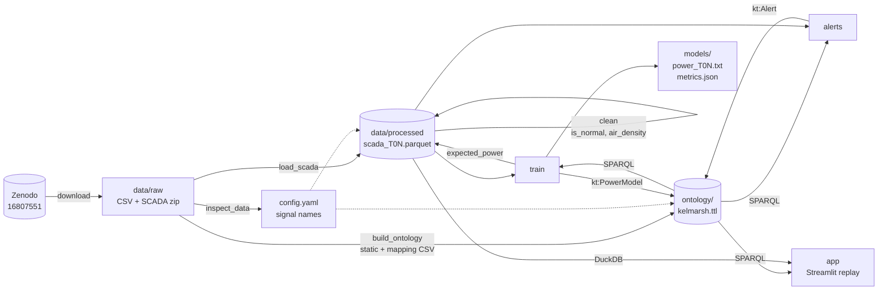

# Kelmarsh Wind Farm Digital Twin (PoC)

A one-day proof of concept of a data-driven digital twin for the Kelmarsh wind
farm (UK, 6 x Senvion MM92, 12.3 MW). It loads and cleans 2022 SCADA data,
describes the farm in an RDF ontology, trains one LightGBM power model per
turbine, raises underperformance alerts, and replays everything in a Streamlit
dashboard. See [docs/spec.md](docs/spec.md) for the full specification.

## Pipeline

The RDF graph (`ontology/kelmarsh.ttl`) is the source of structural truth:
after `build_ontology`, every step discovers turbines, sensors, Parquet paths
and model inputs through SPARQL (`src/graph_utils.py`) and writes its results
(models, alerts) back into the graph. Time series stay in Parquet.



## Setup

Install [uv](https://docs.astral.sh/uv/), then:

```bash
make setup        # uv sync
```

## Run

```bash
make download     # fetch raw data into data/raw/ (MD5-verified, skips existing)
make inspect      # print raw file structure and column names
make data         # load_scada + clean
make ontology     # build ontology/kelmarsh.ttl
make train        # one power model per turbine
make alerts       # underperformance alerts
make app          # Streamlit dashboard
make all          # download through alerts
```

Every script also runs standalone: `uv run python -m src.<name>`.

## Testing and linting

```bash
make test         # uv run pytest
make lint         # uv run ruff check .
```

## Results

From a clean clone, `uv sync` then `make all` runs in about 70 seconds once
the data is downloaded.

**Data and cleaning:** each turbine has 52,560 ten-minute rows (the full year,
no gaps) with 0.1–1.1 % missing values per signal; 74–81 % of rows are normal.

**Power models** (`models/metrics.json`, test set = normal rows in Q4 2022,
rated power 2,050 kW):

| Turbine | MAE (kW) | nMAE | Train rows | Test rows |
|---|---|---|---|---|
| T01 | 71.6 | 0.035 | 30,907 | 10,836 |
| T02 | 80.3 | 0.039 | 32,522 | 9,890 |
| T03 | 62.1 | 0.030 | 31,753 | 10,664 |
| T04 | 63.0 | 0.031 | 28,197 | 10,731 |
| T05 | 71.1 | 0.035 | 31,886 | 10,564 |
| T06 | 53.7 | 0.026 | 29,084 | 10,585 |

All turbines meet the nMAE < 0.05 target.

**Alerts** (24 h rolling residual below −5 % of rated power for at least 6 h):

| Turbine | Alerts | Lost energy (MWh) |
|---|---|---|
| T01 | 3 | 3.0 |
| T02 | 3 | 19.2 |
| T03 | 0 | 0.0 |
| T04 | 2 | 5.2 |
| T05 | 0 | 0.0 |
| T06 | 1 | 0.6 |
| **Total** | **9** | **28.1** |

The largest alert is T02 from 2022-10-04 19:50 to 2022-10-08 14:10 (mean
residual −8.3 % of rated power, 13.3 MWh). Most alerts fall in October,
just after the training period ends (see limitations).

**Graph:** `ontology/kelmarsh.ttl` holds the schema (11 classes,
40 properties), 6 turbines, 42 sensors, 6 trained power models, 9 alerts, and
the provenance of the data: the dataset and its 9 source files.

## Dashboard

- **Replay** tab: status map, KPI cards, 7-day power chart with alerts,
  power curve, alerts table and the sensors SPARQL query.
- **Ontology & lineage** tab: a Graphviz diagram of the selected turbine
  traced back to its sources (specs → `Kelmarsh_WT_static.csv`; each sensor's
  readings → its raw `Turbine_Data_…csv` → the SCADA zip → the Zenodo
  dataset, and the signal mapping CSV), with a sensor filter and active
  alerts in red, plus a class diagram of the schema. Both are built from
  SPARQL queries shown in the tab.

## Known limitations

- One year (2022) only.
- Simple cleaning rules (spec §7.4): a derating plateau at about 1,650 kW above
  rated wind speed is not removed, because the pitch rule only applies below
  rated wind speed.
- No validation of alerts against the status/event logs.
- The models are trained on January–September and tested on October–December
  only; alerts clustered in early October may partly reflect seasonal model
  drift rather than real underperformance.
- Replay is a historical simulation (no streaming), and the dashboard loads
  the whole year of the 6 turbines into memory (about 315,000 rows).

## Attribution

Kelmarsh wind farm data by Cubico Sustainable Investments Ltd, licensed under
CC-BY-4.0. DOI: [10.5281/zenodo.16807551](https://doi.org/10.5281/zenodo.16807551).

## Deviations from spec

- `config.yaml` additionally holds the download URLs/MD5s, the sample interval,
  the rated wind speed (12 m/s) and the standard pressure, so no values are
  hard-coded in scripts.
- `matplotlib` is added (not in spec §4) to save the power curve PNGs.
- `pytest`, `ruff` and `watchdog` (faster Streamlit reloads) are added as dev
  dependencies.
- The SCADA archive holds 6 `Turbine_Data_Kelmarsh_<N>_…csv` files and
  6 `Status_Kelmarsh_<N>_…csv` files (status/event logs, not used). In the
  turbine files the column header is itself a comment line
  (`# Date and time,…`) after 9 metadata lines, so the header is detected as
  the last `#` line before the data. The files have 303 columns and CRLF line
  endings; the static CSV has a UTF-8 BOM.
- The 7 signal column names guessed in spec §6 were all confirmed exactly.
- The mapping CSV's `Greenbyte Title` is the column name without the unit
  suffix (e.g. `Ambient temperature (converter)`), so signals are matched to
  it by stripping the unit.
- `config.yaml` gained a `model` section (`inputs: [wind_speed,
  wind_direction, ambient_temp]`, `target: power`). The model's sensor inputs
  are these three signals; `air_density` and the sin/cos of wind direction
  are derived from them, so they are not sensors in the graph.
- Ontology extensions beyond spec §7.5: `kt:turbineId` (e.g. `"T01"`, used
  by every SPARQL lookup), and `kt:manufacturerTitle` / `kt:greenbyteSignalId`
  on sensors, filled from the mapping CSV where a match exists (all 7 signals
  match). Observable properties (`kt:WindSpeed`, …) are typed
  `sosa:ObservableProperty`; units use QUDT (`unit:M-PER-SEC`, `unit:KiloW`,
  `unit:DEG`, `unit:DEG_C`, `unit:REV-PER-MIN`). `nacelle_direction` is
  attached to the Nacelle (not specified in the spec).
- The mapping CSV lists the unit of `Power` as `kWh`; the SCADA column is
  `Power (kW)` (10-minute mean power), so the sensor unit is `unit:KiloW`.
- `build_ontology.py` already creates one `kt:PowerModel` per turbine with
  its inputs and target (from `config.yaml`), so `train.py` can read the model
  inputs from the graph. `train.py` replaces each node with the trained
  version (metrics, `prov:generatedAtTime`).
- The schema is written first in `ontology/kelmarsh.ttl` by `save_graph`,
  which serialises schema triples and instance triples as two Turtle blocks.
- `train.py` passes `verbose=-1` to `LGBMRegressor` in addition to
  `n_estimators=300`; it only silences LightGBM's console output.
- `graph_utils.get_model_target` (SPARQL) was added so `train.py` reads the
  target signal from the graph, like the inputs.
- The alert rolling window runs over the sequence of normal rows, not over
  clock time, so a 144-sample window may span more than 24 hours when rows
  were excluded. An alert period runs from the first to the last marked
  sample; its mean residual fraction is the mean over the marked samples, so
  it can be above the threshold, which applies to the trailing rolling mean.
- `alerts.py` removes a turbine's existing alerts (`graph_utils.remove_alerts`)
  before adding new ones, so re-running it does not duplicate alerts.
- The dashboard's testable logic (DuckDB loading in UTC, status, KPIs,
  windows, replay stepping) lives in `src/dashboard.py`; `app/app.py` only
  renders. `graph_utils` gained `get_models` (SPARQL) for model metrics, and
  `parquet_path_of` moved there from `train.py` so the app does not import
  LightGBM.
- DuckDB returns timestamps in the machine's local time zone by default, so
  the dashboard sets `TimeZone = 'UTC'` on its connection.
- Map status colours: green = normal row, amber = not normal (excluded by
  cleaning or no data), red = inside an alert period (takes precedence).
- `tests/test_app.py` runs the real app with Streamlit's `AppTest`; it is
  skipped when `data/processed/` has no Parquet files (run `make all` first).
- Provenance extension (for the lineage tab): classes `kt:Dataset` and
  `kt:SourceFile` (both `prov:Entity`), properties `prov:wasDerivedFrom`,
  `kt:partOf`, `kt:fileName`, `kt:downloadUrl`, `kt:md5`, `kt:doi`,
  `kt:publisher`, `kt:license`, `kt:modelFile`, and turbine specs
  `kt:manufacturer`, `kt:turbineModel`, `kt:commissioningDate` from the static
  CSV. Dataset metadata lives in `config.yaml` (`dataset`). Turbines derive
  from the static CSV; sensors from their raw SCADA file and, where matched,
  the mapping CSV; raw files are part of the zip, which is part of the dataset.
